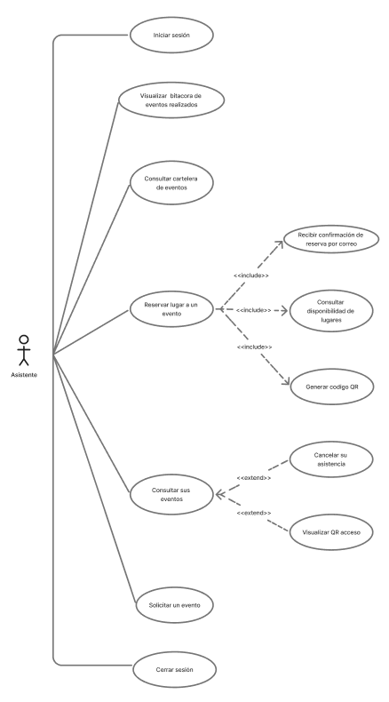
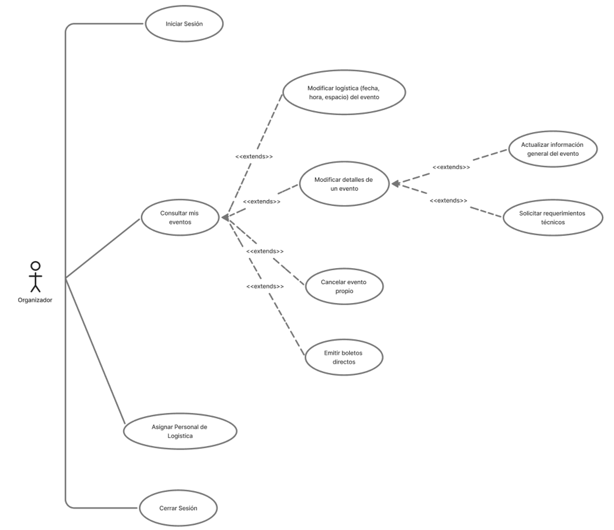
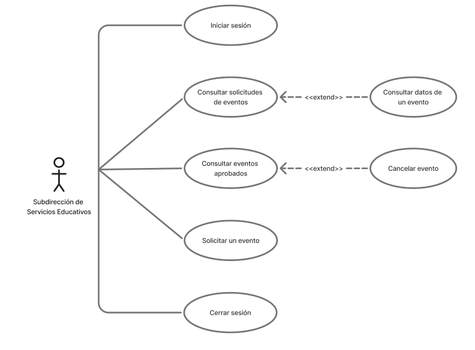
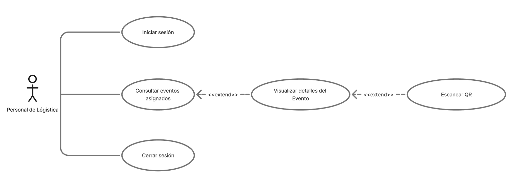
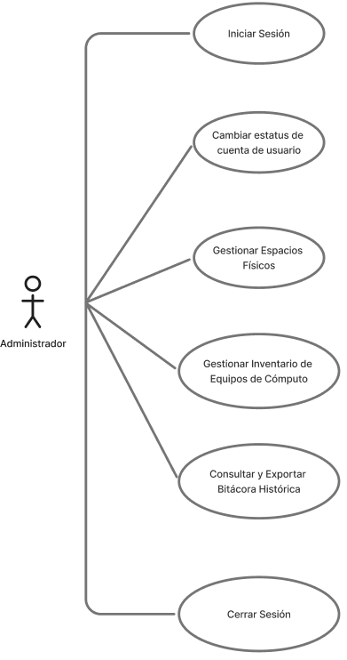

# Actores, Diagramas de Casos de Uso y Catálogos — EventOS (v2.1)

> [!NOTE] Navegación Rápida
> **Hub del Proyecto:** [00-Proyecto-EventOS](./00-Proyecto-EventOS.md) | **Requerimientos y Reglas:** [01-Requerimientos-y-Reglas-de-Negocio](./01-Requerimientos-y-Reglas-de-Negocio.md) | **Casos de Uso (`CU-01`–`CU-39`):** [00-Indice-Casos-de-Uso](./03-Casos-de-Uso/00-Indice-Casos-de-Uso.md)

---

## 1. Descripción de Actores del Sistema

### Asistente

Este actor interactúa con la plataforma para consultar la cartelera (`CU-04` en `UI04`) y gestionar su participación. Tiene la capacidad de reservar su lugar o butaca con retención temporal de 5 minutos (`CU-15`, `CU-16` en `UI06` y `UI30`), generar y visualizar su boleto digital de acceso mediante código QR cuando la modalidad del evento lo requiera (`CU-17`, `CU-20` en `UI09`), administrar o cancelar sus reservas activas (`CU-18`, `CU-19` en `UI08`), consultar su historial de participación (`CU-14` consolidado en `UI08`) y solicitar la creación de un evento (`CU-21` en `UI07`) contando previamente con su identidad verificada (`UI32`). Puede operar desde una cuenta de tipo `Usuario Interno` (comunidad ESCOM/IPN) o `Usuario Externo` (público general), lo cual determinará su visibilidad en la cartelera.

### Organizador

Este actor es responsable de la propuesta, creación y administración operativa de los eventos bajo su responsabilidad (privilegio otorgado por evento conforme a `RN-02`), pudiendo pertenecer a la comunidad institucional, a un club estudiantil o a una entidad externa. Sus capacidades incluyen consultar y administrar sus eventos únicos y multi-actividad (`CU-24` en `UI14`/`UI15`), reprogramar o reubicar su logística y cupo configurable (`CU-25` en `UI16`), actualizar la información general y requerimientos técnicos de laboratorio (`CU-26`, `CU-27`, `CU-28` en `UI15`/`UI16`), agregar ponentes (`CU-10` en `UI16`), invitar asistentes por subevento mediante correo, carga masiva o enlace privado (`/eventos/privado/:tokenSubEvento`, `CU-30`), asignar o registrar personal de logística (`CU-31`, `CU-32` en `UI27`) y cancelar sus eventos especificando un motivo obligatorio (`CU-29`).

### Subdirección de Servicios Educativos

Este actor es el encargado de consultar y evaluar las solicitudes de eventos pendientes de aprobación (`CU-06`, `CU-07` en `UI11`/`UI12`), dictaminando si se aprueban, rechazan o requieren cambios (modal como subcomponente de `UI12`) con base en la agenda de disponibilidad y el impacto académico frente a las clases regulares. Asimismo, puede consultar los eventos aprobados (`CU-08` en `UI13`), cancelarlos justificadamente (`CU-09`), agregar ponentes (`CU-10` en `UI16`), solicitar eventos cuyas solicitudes se aprueban de forma automática sin modal de urgencia (`CU-11` en `UI07`), registrar personal de logística (`CU-12` en `UI27`) y consultar la bandeja (`UI10`) y dictamen de verificación de identidad de los usuarios (`CU-38` en `UI31`).

### Personal de Logística

Actor operativo cuyo propósito en el sistema es la validación de acceso de los asistentes en los eventos a los que ha sido asignado. Activa su cuenta mediante token (`/activar-logistica` dentro de `UI02`), interactúa con el panel de eventos asignados (`CU-22` en `UI18`), gestiona el control de acceso por subevento (`UI17`), visualiza los detalles del evento (`CU-05` en `UI05`) y utiliza la cámara del dispositivo desde el navegador web para escanear los códigos QR de los boletos digitales (`CU-23` en `UI19`), recibiendo el dictamen del sistema (acceso válido, código no reconocido o código ya validado) y actualizando el estado del boleto a `Ingresado`.

### Administrador

Este actor cuenta con privilegios de gestión sobre las cuentas de usuario, la infraestructura de espacios físicos y la auditoría del sistema desde su menú principal (`UI26`). Puede asignar o revocar jefes de departamento con dominio `@ipn.mx` (`CU-33` en `UI24`), activar o desactivar cuentas de usuario mediante borrado lógico (`CU-34` en `UI21`), actualizar el estado operativo (`Activo`, `Mantenimiento`, `Inactivo`) y aforo máximo de los espacios físicos de ESCOM (`CU-35` en `UI22`), administrar el estado del inventario de equipos de cómputo por laboratorio (`CU-36` en `UI23`), consultar y exportar en formato CSV (`.csv`) la bitácora histórica inmutable del sistema (`CU-37` en `UI20`) y consultar/evaluar el estado de verificación de usuarios (`CU-38` en `UI10`/`UI31`).

---

## 2. Diagramas de Casos de Uso por Actor

### 2.1. Asistente


### 2.2. Organizador


### 2.3. Subdirección de Servicios Educativos


### 2.4. Personal de Logística


### 2.5. Administrador


---

## 3. Catálogo Oficial de Pantallas (`UI01` – `UI32`)

> [!TIP] Guía de Estilo, Wireframes y Mockups en Figma
> Para consultar la tipografía (`Merriweather`), paleta institucional (`#5F1B36` / `#1B585F`), tabla de correspondencia oficial `UI01`–`UI32` y capturas de **Wireframes** y **Mockups** (Desktop y Móvil), revisa [04-Diseno-UI](./04-Diseno-UI.md).

| Actor / Rol | ID | Nombre de la Pantalla / Componente |
| :--- | :---: | :--- |
| Todos | `UI01` | Pantalla de Inicio de Sesión *(incluye solicitud `/recuperar-contrasena`)* |
| Todos / Asistente / Logística | `UI02` | Pantalla de Registro de Usuario *(incluye `/confirmar-registro` y activación de logística `/activar-logistica`)* |
| Asistente | `UI03` | Menú Principal del Asistente |
| Todos / Público General | `UI04` | Cartelera de Eventos *(en todos sus casos)* |
| Todos / Público General | `UI05` | Detalles del Evento *(incluye subvista `UI05.1` Detalles del subevento y acceso por enlace privado `/eventos/privado/:tokenSubEvento`)* |
| Asistente | `UI06` | Mapa de Asientos y Disponibilidad del Recinto *(con retención temporal de 5 min)* |
| Asistente / Subdirección | `UI07` | Formulario de Solicitud de Evento *(único y multi-actividad, cupo configurable y tooltips)* |
| Asistente | `UI08` | Consultar sus Eventos (Reservas del Asistente o Mis Boletos) |
| Asistente | `UI09` | Boleto Digital y Código QR *(Auditorio, Sala 14, Laboratorios y Móvil)* |
| Subdirección / Administrador | `UI10` | Visualización de Verificación de Usuario por Subdirección (Solicitudes de Verificación de Cuentas) *(`/subdireccion/verificaciones`)* |
| Subdirección de Servicios Educativos | `UI11` | Panel de Solicitudes Pendientes |
| Subdirección de Servicios Educativos | `UI12` | Detalles de Evento para Evaluación *(incluye Modal de Solicitud de Cambios / Comparador Logístico)* |
| Subdirección de Servicios Educativos | `UI13` | Panel de Eventos Aprobados |
| Organizador | `UI14` | Panel Consultar Mis Eventos |
| Organizador | `UI15` | Administración y Detalles del Evento (Único y Multi-actividad) |
| Organizador | `UI16` | Formulario de Modificación de Evento *(Único y Multi-actividad; incluye ponentes, invitados por subevento y cupo)* |
| Personal de Logística | `UI17` | Control de Acceso *(`/control-acceso/:idSubEvento`)* |
| Personal de Logística | `UI18` | Panel de Eventos Asignados |
| Personal de Logística | `UI19` | Pantalla de Escáner QR |
| Administrador | `UI20` | Bitácora Histórica de Eventos / del Sistema *(exportación CSV)* |
| Administrador | `UI21` | Gestión de Cuentas de Usuario |
| Administrador | `UI22` | Panel de Gestión de Espacios Físicos |
| Administrador | `UI23` | Gestión de Equipos de Laboratorio |
| Administrador | `UI24` | Asignar Jefes de Departamento *(antes `UI34`; solo `@ipn.mx`)* |
| Subdirección de Servicios Educativos | `UI25` | Menú Principal de Subdirección |
| Administrador | `UI26` | Menú Principal de Administración |
| Subdirección / Organizador | `UI27` | Agregar Personal de Logística |
| Todos | `UI28` | Perfil de Usuario |
| Todos / Público | `UI29` | Restablecer Contraseña *(asociada a `CU-39`, antes `UI35`)* |
| Asistente | `UI30` | Reservar Lugar — Resumen de la Reservación *(admisión general y registro simple sin QR)* |
| Subdirección / Administrador | `UI31` | Visualización de Verificación de Usuario por Subdirección (Detalle de Solicitud) *(`/subdireccion/verificaciones/:id`, constancia PDF en R2)* |
| Asistente / Usuario Externo | `UI32` | Solicitud de Verificación de Cuenta / Identidad *(vigencia trimestral, PDF máx. 5 MB en R2)* |

---

## 4. Catálogo de Mensajes de Error (`MSG-E-01` – `MSG-E-55`)

| Código | Mensaje de Error |
| :---: | :--- |
| **`MSG-E-01`** | El evento ya ha concluido. |
| **`MSG-E-02`** | Cantidad inválida. Ingrese un número entero válido. |
| **`MSG-E-03`** | La cantidad solicitada excede el límite disponible. |
| **`MSG-E-04`** | La cantidad solicitada excede el aforo máximo de seguridad del recinto. Solo quedan X lugares disponibles. |
| **`MSG-E-05`** | Evento sin lugares disponibles. |
| **`MSG-E-06`** | Evento no encontrado o cancelado. |
| **`MSG-E-07`** | Evento finalizado o inactivo. |
| **`MSG-E-08`** | Error de conexión con la base de datos. |
| **`MSG-E-09`** | Uno o más asientos seleccionados ya no están disponibles. Por favor, elija otros lugares. |
| **`MSG-E-10`** | Sesión expirada o inválida. *Quitar* |
| **`MSG-E-11`** | Por favor, completa todos los campos obligatorios resaltados para continuar. |
| **`MSG-E-12`** | Ya cuentas con un boleto de asistente para este evento. Si deseas postularte como staff, primero debes cancelar tu reserva actual. |
| **`MSG-E-13`** | Dato requerido faltante. La descripción no puede estar vacía. |
| **`MSG-E-14`** | La descripción excede el límite máximo de caracteres permitidos. |
| **`MSG-E-15`** | Debe seleccionar un tipo de alcance válido para continuar. |
| **`MSG-E-16`** | Formato de etiqueta inválido. Por favor, verifique los caracteres ingresados. |
| **`MSG-E-17`** | Límite de etiquetas excedido. No es posible asignar más etiquetas a este evento. |
| **`MSG-E-18`** | Error de conexión con la base de datos al cargar las tarjetas. |
| **`MSG-E-19`** | Operación fallida al intentar actualizar el estado del equipo. |
| **`MSG-E-20`** | Error: Ya tienes una reserva para este evento. |
| **`MSG-E-21`** | Advertencia: Ingrese un correo válido. |
| **`MSG-E-22`** | Acceso denegado, el código QR no ha sido reconocido por el sistema. |
| **`MSG-E-23`** | Acceso denegado, el código QR ya ha sido validado en el sistema. |
| **`MSG-E-24`** | El lugar seleccionado ya no se encuentra disponible. |
| **`MSG-E-25`** | El periodo de registro para este evento ha finalizado. |
| **`MSG-E-26`** | No fue posible generar el código QR. Intenta nuevamente. |
| **`MSG-E-27`** | La reserva no ha sido confirmada. |
| **`MSG-E-28`** | No fue posible consultar tus eventos. Intenta nuevamente. |
| **`MSG-E-29`** | Dato requerido faltante. La justificación no puede estar vacía. |
| **`MSG-E-30`** | No fue posible guardar el boleto digital. Intenta nuevamente. |
| **`MSG-E-31`** | No hay registros de eventos disponibles. |
| **`MSG-E-32`** | Error al exportar el archivo. |
| **`MSG-E-33`** | La solicitud seleccionada ya no se encuentra pendiente de aprobación. Actualice el listado para continuar. |
| **`MSG-E-34`** | El ponente ya se encuentra registrado en el evento seleccionado. |
| **`MSG-E-35`** | No es posible agregar ponentes a un evento que no se encuentra aprobado. |
| **`MSG-E-36`** | La fecha u horario del evento no es válido. Verifique que la fecha sea futura y que la hora de finalización sea posterior a la hora de inicio. |
| **`MSG-E-37`** | El correo electrónico ingresado ya se encuentra registrado en el sistema. |
| **`MSG-E-38`** | No cuenta con los permisos necesarios para registrar personal de logística. |
| **`MSG-E-39`** | El personal de logística ya se encuentra asignado al evento seleccionado. |
| **`MSG-E-40`** | No es posible asignar personal de logística a un evento que no se encuentra aprobado. |
| **`MSG-E-41`** | No tiene autorización para consultar este evento porque no se encuentra asignado a él. |
| **`MSG-E-42`** | No se pudo acceder a la cámara del dispositivo. Verifique los permisos e inténtelo nuevamente. |
| **`MSG-E-43`** | La cuenta seleccionada no existe o ya no se encuentra disponible. |
| **`MSG-E-44`** | No es posible actualizar el recinto porque existen eventos aprobados que podrían verse afectados. Revise sus asignaciones. |
| **`MSG-E-45`** | No es posible verificar al usuario porque su información de verificación está incompleta. |
| **`MSG-E-46`** | Las contraseñas ingresadas no coinciden. |
| **`MSG-E-47`** | El espacio ya se encuentra solicitado o reservado para el horario seleccionado. |
| **`MSG-E-48`** | El destinatario ya cuenta con un boleto activo para este evento. |
| **`MSG-E-49`** | No se encontró una cuenta activa para el destinatario del boleto directo. |
| **`MSG-E-50`** | No es posible registrar más personal de logística. El evento ha alcanzado el límite máximo de 10 integrantes. |
| **`MSG-E-51`** | "El usuario seleccionado ya tiene una jefatura activa en el departamento". |
| **`MSG-E-52`** | "El número de empleado ingresado ya se encuntra asignado a otro usuario". |
| **`MSG-E-53`** | "El número de empleado debe contener únicamente caracteres numéricos.". |
| **`MSG-E-54`** | Para solicitar recintos institucionales es indispensable haber acreditado tu identidad. |
| **`MSG-E-55`** | Cuenta bloqueada temporalmente por seguridad tras 5 intentos fallidos. Intenta más tarde o restablece tu contraseña. |

---

## 5. Catálogo de Mensajes Informativos (`MSG-I-01` – `MSG-I-26`)

| Código | Mensaje Detallado |
| :---: | :--- |
| **`MSG-I-01`** | No hay solicitudes pendientes de aprobación en este momento. |
| **`MSG-I-02`** | El evento se ha cancelado exitosamente. |
| **`MSG-I-03`** | Sin eventos registrados en la bitácora. |
| **`MSG-I-04`** | Sesión finalizada con éxito. |
| **`MSG-I-05`** | Tu postulación ha sido enviada con éxito. |
| **`MSG-I-06`** | La solicitud fue aprobada exitosamente. |
| **`MSG-I-07`** | La solicitud fue rechazada exitosamente. |
| **`MSG-I-08`** | Operación realizada con éxito. |
| **`MSG-I-09`** | Operación realizada con éxito. Evento en espera de revisión debido a cambio de duración. |
| **`MSG-I-10`** | Operación exitosa al actualizar la descripción del evento. |
| **`MSG-I-11`** | Operación exitosa al actualizar el alcance del evento |
| **`MSG-I-12`** | Operación exitosa al asignar las etiquetas del evento. |
| **`MSG-I-13`** | Operación realizada con éxito. Recinto actualizado. |
| **`MSG-I-14`** | No hay eventos disponibles, consulte más tarde. |
| **`MSG-I-15`** | No hay eventos disponibles que cumplan con los filtros seleccionados. |
| **`MSG-I-16`** | Operación exitosa, su reserva se ha generado correctamente. |
| **`MSG-I-17`** | Proceso interrumpido con éxito, reserva cancelada. |
| **`MSG-I-18`** | No existen eventos vinculados a este perfil. |
| **`MSG-I-19`** | Acceso válido. |
| **`MSG-I-20`** | No cuentas con eventos registrados. |
| **`MSG-I-21`** | No hay eventos aprobados registrados en este momento. |
| **`MSG-I-22`** | No se encontraron eventos que coincidan con el criterio de búsqueda. |
| **`MSG-I-23`** | No se encontraron registros que coincidan con los filtros seleccionados. |
| **`MSG-I-24`** | Para reservar tu lugar en este evento es necesario iniciar sesión o crear una cuenta. |
| **`MSG-I-25`** | La capacidad operativa del laboratorio ha disminuido. Existen eventos aprobados que requieren revisión. |
| **`MSG-I-26`** | Invitación aceptada. Por favor, selecciona tu asiento en el mapa para confirmar tu lugar y generar tu boleto. |

---

## 6. Catálogo de Mensajes de Pantalla / Confirmación (`MSG-P-01` – `MSG-P-07`)

| Código | Mensaje Detallado |
| :---: | :--- |
| **`MSG-P-01`** | ¿Desea confirmar la cancelación del evento seleccionado? |
| **`MSG-P-02`** | ¿Desea cerrar su sesión? |
| **`MSG-P-03`** | ¿Desea aprobar el evento? |
| **`MSG-P-04`** | ¿Desea rechazar el evento? |
| **`MSG-P-05`** | ¿Desea confirmar el cambio de estado de la cuenta seleccionada? |
| **`MSG-P-06`** | ¿Desea confirmar la actualización del recinto seleccionado? |
| **`MSG-P-07`** | ¿Desea confirmar el cambio de estado de verificación del usuario seleccionado? |

---

## 7. Plantillas Estandarizadas de Correo Electrónico (Cambios de Recinto y Aforo)

Textos estandarizados para las notificaciones automáticas enviadas por correo electrónico ante cambios de recinto, modalidad de acceso o reducción de aforo (`RN-31`, `CU-07`, `CU-25`).

### a) Correo A — Actualización de Recinto (Boleto Conservado)

- **Asunto:** `Actualización de ubicación para [Nombre del Evento]`
- **Cuerpo del mensaje:**

```text
Hola, [Nombre del Asistente]:

Te informamos que el evento [Nombre del Evento], programado para el día [Fecha], ha cambiado de ubicación.

Nuevo Recinto: [Nombre del Recinto Destino]
Ubicación: [Ubicación del Recinto]
Horario: [Hora de Inicio]

Tu boleto actual sigue siendo totalmente válido. No es necesario realizar ningún proceso de re-registro ni generar un nuevo comprobante; puedes presentar el mismo código QR que recibiste previamente al momento de ingresar.

Si tienes dudas adicionales, puedes contactar al equipo organizador a través de este medio.

Saludos cordiales,
Equipo de EventOS
```

### b) Correo B — Cancelación por Cambio de Modalidad (Requiere Nuevo Registro)

- **Asunto:** `IMPORTANTE: Cambio de sede y reasignación de accesos - [Nombre del Evento]`
- **Cuerpo del mensaje:**

```text
Hola, [Nombre del Asistente]:

Te contactamos para informarte que el evento [Nombre del Evento] ha tenido un cambio en el recinto de confirmación, lo cual modifica la distribución de asientos y la capacidad del lugar.

Debido a los requerimientos del nuevo espacio ([Nombre del Recinto Destino]), tu boleto anterior ha sido invalidado automáticamente en nuestro sistema.

Para asegurar tu asistencia, es necesario que realices un nuevo registro para seleccionar tu espacio en la nueva configuración:

Enlace para nuevo registro: [Enlace a EventOS]
Ubicación del nuevo recinto: [Ubicación del Recinto]

Lamentamos los inconvenientes que este cambio pueda ocasionarle a tu logística y agradecemos tu comprensión.

Atentamente,
Equipo de EventOS
```

### c) Correo C — Cambio a Acceso Libre

- **Asunto:** `Actualización de acceso: Entrada libre para [Nombre del Evento]`
- **Cuerpo del mensaje:**

```text
Hola, [Nombre del Asistente]:

Queremos informarte que la modalidad de entrada para [Nombre del Evento], a celebrarse el próximo [Fecha], ha sido modificada a Acceso Libre.

El evento se llevará a cabo en [Nombre del Recinto Destino] ([Ubicación del Recinto]).

¿Qué significa esto para ti?

Tu boleto o registro previo ha sido cancelado por el sistema, ya que no se requerirá presentar código QR ni boleto impreso para ingresar.
El acceso se registrará directamente en la entrada por orden de llegada hasta completar el aforo del recinto.

Te recomendamos llegar con anticipación para asegurar tu lugar.

Saludos cordiales,
Equipo de EventOS
```

### d) Correo D — Cancelación por Sobrecupo (Reducción de Aforo — Flujo FIFO)

- **Asunto:** `Cancelación de boleto por reducción de aforo - [Nombre del Evento]`
- **Cuerpo del mensaje:**

```text
Hola, [Nombre del Asistente]:

Queremos informarte que el evento [Nombre del Evento] ha tenido que cambiar de sede a un recinto de menor capacidad. Para gestionar el acceso con justicia y transparencia, los lugares se han conservado respetando de manera estricta el orden cronológico de registro.

Lamentamos profundamente comunicarte que, debido a esta reducción del aforo máximo, tu boleto ha tenido que ser cancelado ya que se superó el límite de lugares disponibles en la nueva ubicación.

Ofrecemos una sincera disculpa en nombre de la organización por los inconvenientes y molestias que esta situación imprevista pueda ocasionar en tus planes.

Atentamente,
Equipo de EventOS
```

---

## 8. Notas de Consolidación (Versión 2.1 — Catálogo `UI32` y Cupo Configurable sin Sobrecupo)

- La cartelera y la visualización de detalles del evento se mantienen como casos universales `CU-04` (`UI04`) y `CU-05` (`UI05`/`UI05.1`, incluyendo acceso por enlace privado `/eventos/privado/:tokenSubEvento`).
- El catálogo oficial validado contra la aplicación real consta de exactamente **32 pantallas (`UI01` a `UI32`)** en correspondencia con Figma y los **39 Casos de Uso (`CU-01`–`CU-39`)**:
  - **Restablecer Contraseña (`CU-39`)** pasa de `UI35` a `UI29` (la solicitud desde `/recuperar-contrasena` se agrupa en `UI01`).
  - **Asignar Jefes de Departamento (`CU-33`)** pasa de `UI34` a `UI24`, restringida al dominio `@ipn.mx` (excluyendo `@alumno.ipn.mx`).
  - **Reservar Lugar (Resumen de la Reservación, `CU-15`)** ocupa `UI30` para admisión general y registro simple sin QR, mientras `UI09` representa el **Boleto Digital y Código QR** en Auditorio, Sala 14, Laboratorios y Móvil.
  - **Visualización de Verificación de Usuario por Subdirección (Solicitudes de Verificación de Cuentas, `CU-38`)** ocupa `UI10` (`/subdireccion/verificaciones`) complementando el detalle y dictamen en `UI31` (**Visualización de Verificación de Usuario por Subdirección (Detalle de Solicitud)** en `/subdireccion/verificaciones/:id`) con constancia PDF (`<= 5 MB`) en bucket privado de Cloudflare R2.
  - **Control de Acceso (`CU-22`/`CU-23`)** ocupa `UI17` (`/control-acceso/:idSubEvento`); la activación por token de logística (`/activar-logistica`) y confirmación de correo (`/confirmar-registro`) se consolidan bajo `UI02`; la captura de ponentes (`CU-10`) y requerimientos técnicos de laboratorio (`CU-28`) viven integrados en `UI15`/`UI16`; y la consulta de eventos pasados del asistente (`CU-14`) se gestiona dentro de `UI08` (descartando el calendario institucional previo y el alta manual exclusiva desde Administrador `UI33`).
- Se simplifica `RN-07` sustituyendo el sobrecupo escalonado por **cupo máximo configurable sin sobrecupo (`min(cupoMaximo, aforoActualRecinto)`)** y se registran los aforos físicos oficiales confirmados por ESCOM (`Auditorio Principal: 242`, `Sala 14: 100`, `Laboratorios 2104–2107: 36 equipos para alumnos + 1 estación de docente`).
- Se documentan las capacidades implementadas al cierre de `develop`: invitaciones privadas **por subevento** con carga masiva por lotes/CSV y enlace compartible, retención temporal de asientos (5 min en `UI06`), tooltips (`InfoTooltip`/`ModalidadAccesoHelp`), almacenamiento en Cloudflare R2, endurecimiento (`helmet` + sesión única JWT) y exportación de bitácora en CSV (`.csv`).

