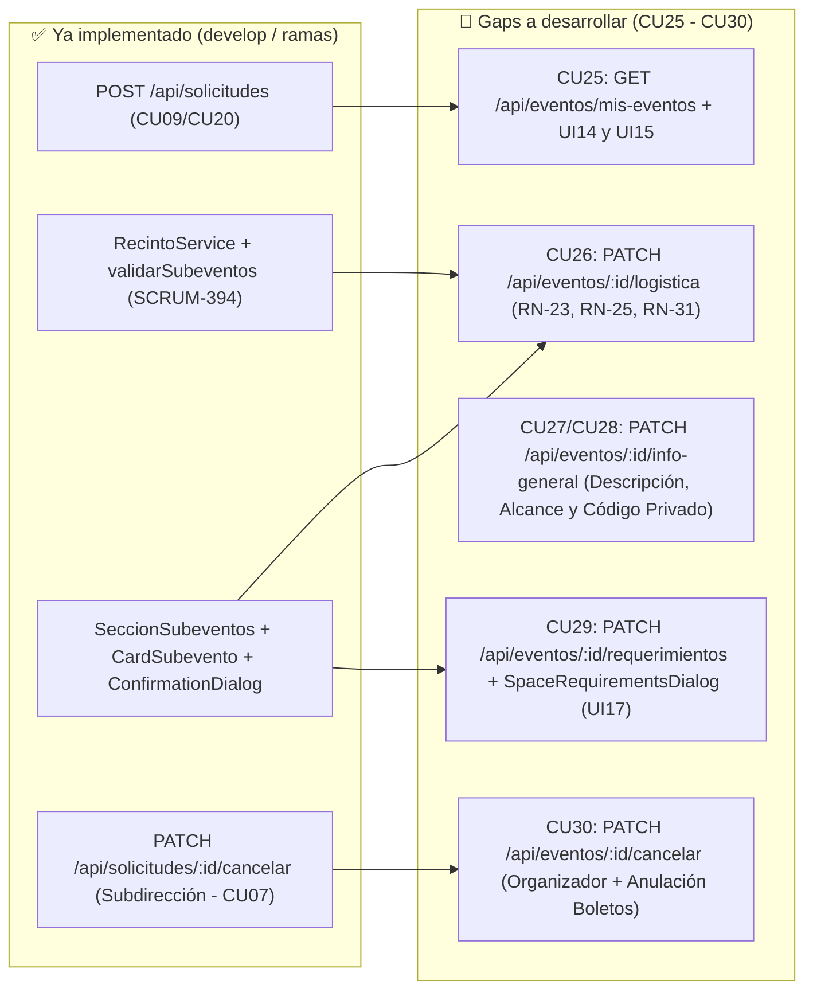
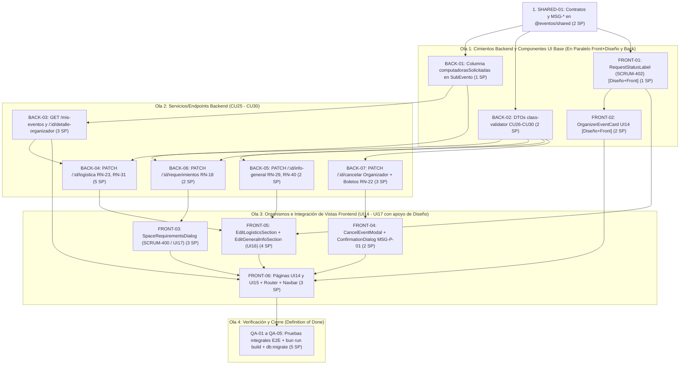

# 📋 Propuesta de Backlog — Módulo: Gestión y Modificación de Eventos (Organizador) — Subequipo B

> [!NOTE] Contexto, Alcance y Asignación Exclusiva al Subequipo B
> Propuesta técnica y funcional de **Product Backlog** para la épica **"Gestión y Modificación de Eventos (Organizador)"** (`CU25` a `CU30`), asignada de forma exclusiva al **Subequipo B**:
> - **Backend y Base de Datos:** Yair Emmanuel Arciniega Valdez (`Yair`)
> - **Diseño y Maquetación Frontend (UI/React):** Lorena Zúñiga González (`Lorena`)
> - **Frontend e Integración (Estado/API/Ruteo):** Víctor Ariel Marcial Jiménez (`Víctor`)
> - **Pruebas y Aseguramiento de Calidad (QA):** Leonardo Vargas Rodríguez (`Leonardo`)
>
> Formulada a partir del análisis cruzado entre:
> 1. **Avances en Jira (`Proyecto SCRUM`) y código en `develop` / ramas activas (`origin/feature/gestion-espacios-backend`, `origin/feature/Logica-Muestreo-y-Aprobacion-de-Eventos-UI12`)**.
> 2. **Diseños oficiales en Figma (`DISEÑO-ADS` — Key: `16hWE2vpbC6m8HG15tL2V1`) y mockups en `docs/04-Diseno-UI.md`**.
> 3. **Especificaciones de Casos de Uso (`CU25`–`CU30`, sin manejo de etiquetas temáticas), Reglas de Negocio (`RN-01`–`RN-45`) y Catálogo de Mensajes (`MSG-E-*`, `MSG-I-*`, `MSG-P-*`)**.
> 4. **Arquitectura Monorepo 100% Bun (`@eventos/shared`, `apps/backend` NestJS + TypeORM, `apps/frontend` React + Vite + Atomic Design)**.

---

## 1. Resumen de Reutilización y Análisis de Brechas (Gap Analysis)

### 1.1. Activos Existentes que se Reutilizarán Directamente

| Capa | Elemento Existente | Referencia Jira / Ruta en Monorepo | Cómo se Reutiliza / Extiende en este Módulo |
| :--- | :--- | :--- | :--- |
| **Shared** | `Evento`, `SubEvento`, `Fecha`, `Recinto`, `SubeventoPayload`, `AlcanceEvento`, `EstadoEvento`, `EstadoSubEvento`, `RecintoId` | `SCRUM-264`, `SCRUM-345` `packages/shared/src/index.ts` | Contratos base compartidos. Se extenderán con payloads tipados para edición logística (`CU26`), información general (`CU28`), requerimientos técnicos (`CU29`) y resumen de tarjeta en `UI14` (`CU25`). *(Nota: se descarta el uso de etiquetas en eventos).* |
| **Backend** | `EventosService.validarTraslapeInterno` y `consultarColisionBD` | `SCRUM-266`, `SCRUM-283`, `SCRUM-394` `apps/backend/src/modules/eventos/services/eventos.service.ts` | Se reutilizan en `CU26` para validar que los nuevos bloques horarios no se traslapen entre sí ni contra eventos `ACEPTADO` o `ENPROCESO` (`RN-06`, `MSG-E-47` / `MSG-E-24`), agregando el parámetro `idEventoExcluir` para no colisionar contra los bloques actuales del propio evento. |
| **Backend** | `RecintoService.validarRecinto`, `listarEspaciosDisponibles`, `obtenerAgendaEspacio` | `SCRUM-278`, `SCRUM-371`, `SCRUM-393`, `SCRUM-394` `apps/backend/src/modules/recintos/services/recinto.service.ts` | Se reutilizan en `CU26` y `CU29` para comprobar estado `HABILITADO` (`RN-34`), bloqueo de QR en Sala 14 (`RN-04`), obligatoriedad de QR y límite de `computadorasDisponibles` en laboratorios (`RN-18`, `RN-38`). |
| **Backend** | `EventosService.obtenerDetalleSolicitud` | `SCRUM-277` `apps/backend/src/modules/eventos/services/eventos.service.ts` | Se reutiliza para poblar `UI15` (`CU25` / `CU27`), añadiendo conteo de boletos activos emitidos, código/enlace de invitación si es `Privado` (`RN-29`) y validación de acceso para el Organizador dueño (`evento.idOrganizador === req.user.sub`). |
| **Backend** | `EventosService.cancelarSolicitud`, `CancelarSolicitudDto` y `BitacoraEventoEntity` | `SCRUM-305`, `SCRUM-306` `apps/backend/src/modules/eventos/` | Se reutiliza toda la lógica de cambio a `EstadoEvento.CANCELADO`, liberación de `subEvento` (`EstadoSubEvento.CANCELADO`, `RN-22`) y registro en `bitacoraEvento` (`RNF-26`), extendiéndola para permitir al Organizador propietario (`CU30`) e invalidar los boletos asociados (`EstadoBoleto.CANCELADO`). |
| **Backend** | `StorageService` y `posterOptions` | `SCRUM-265` `apps/backend/src/common/storage/storage.service.ts` | Resolución de URLs públicas de pósters en `UI14`/`UI15`. |
| **Frontend** | Átomos base (`Button`, `Badge`, `Input`, `Select`, `TextArea`, `InputFile`, `Label`, `FieldMessage`, `Spinner`, `TextLink`) | `SCRUM-334` a `SCRUM-344` `apps/frontend/src/components/atoms/` | Se reutilizan íntegramente en todos los formularios (`UI14`, `UI15`, `UI16`, `UI17`) respetando la paleta (`--color-eventos-primary: #5F1B36`, `--color-secondary: #1B585F`) y tipografía `Merriweather`. |
| **Frontend** | Moléculas (`FormField`, `FormHeader`, `Modal`, `RequestStatusLabel`) | `SCRUM-402` `apps/frontend/src/components/molecules/` | `FormField` y `FormHeader` estructuran `UI15` y `UI16`. `RequestStatusLabel` se completa envolviendo `Badge` para estandarizar los estados (`Pendiente`, `Aprobado`, `Cancelado`, `Rechazado`, `Finalizado`). |
| **Frontend** | Organismos (`SeccionSubeventos` + `CardSubevento` como `EventScheduleEditor`, `SeccionDatosPrellenados`, `SeccionDatosEvento`, `ConfirmationDialog`) | `SCRUM-333`, `SCRUM-401` `apps/frontend/src/components/organisms/` | `SeccionSubeventos` y `CardSubevento` se reutilizan tanto en modo lectura (`readOnly` en `UI15`) como en modo edición (`UI16` - `CU26`). `ConfirmationDialog` gestiona la confirmación `MSG-P-01` (`CU30`). |
| **Frontend** | Hook `useEspaciosDisponibles` | `SCRUM-393` `apps/frontend/src/hooks/useEspaciosDiponibles.ts` | Provee en tiempo real los espacios habilitados y `computadorasDisponibles` para los selectores de `CardSubevento` (`CU26`) y `SpaceRequirementsDialog` (`CU29`). |

---

### 1.2. Brechas Identificadas (Gaps por Cubrir)

1. **Verificación de Propiedad por Evento (`RN-02`)**:
   - Actualmente `SolicitudesController` restringe `GET`, `PATCH` a `@Roles(TipoCuentaUsuario.SUBDIRECCION)`. El rol de `Organizador` es contextual por evento (`evento.idOrganizador === req.user.sub`, `RN-02`). Se requiere validar en `EventosService` que el usuario autenticado sea el `idOrganizador` del evento (o `SUBDIRECCION` cuando aplique).
2. **Exclusión del Propio Evento en Validación de Colisiones (`CU26` / `RN-06`)**:
   - `EventosService.consultarColisionBD(subevento)` actualmente evalúa todos los subeventos de la BD. Al reprogramar un evento existente (`CU26`), debe recibir `idEventoExcluir?: number` para no reportar falso positivo de colisión contra sus propios horarios previos.
3. **Regla de Anticipación de 7 Días y Revocación de Aprobación por Cambio de Duración (`RN-23`, `RN-31`, `MSG-I-09`)**:
   - Falta la lógica que valide al menos 7 días naturales de anticipación para modificar logística de un evento `ACEPTADO`, calcule si la duración de los bloques (`horaFin - horaInicio`) cambió respecto a la aprobada originalmente y, de ser así, revoque el estado a `EstadoEvento.ENPROCESO` (`Pendiente`) retornando `MSG-I-09`.
4. **Actualización de Descripción y Alcance con Enlace/Código de Invitación Privado (`CU28`, `RN-29`, `RN-40`)**:
   - Al haberse eliminado el manejo de etiquetas en los eventos, `CU28` es una actualización directa sobre la entidad `EventoEntity` (`descripcion` e `idAlcance`, sin requerir tabla puente ni transacción manual), conservando intactos los registros previos (`RN-40`) y generando/devolviendo el enlace directo y código de invitación cuando el alcance se actualiza a `Privado` (`RN-29`).
5. **Persistencia y Validación de Requerimientos Técnicos en Laboratorio (`CU29`, `RN-18`, `UI17`)**:
   - Falta completar el organismo `SpaceRequirementsDialog` (`SCRUM-400`) y conectarlo al botón `"Ver detalles de espacio"` en `CardSubevento` y en `UI15`, así como el endpoint para guardar la cantidad entera de computadoras solicitadas validando `1 <= cantidad <= recinto.computadorasDisponibles` (`MSG-E-02`, `MSG-E-03`).
6. **Anulación Efectiva de Boletos Emitidos al Cancelar (`RN-22`, `CU30`)**:
   - `EventosService.cancelarSolicitud` actualiza `evento` y `subEvento`, pero aún no actualiza a `EstadoBoleto.CANCELADO` los registros en la tabla `boleto` vinculados mediante `asistenteEvento`, ni valida los códigos exactos `MSG-E-29` / `MSG-E-11` / `MSG-E-06` / `MSG-E-01` para el flujo del Organizador.
7. **Vistas del Organizador en Frontend (`apps/frontend/src/features/organizer/`)**:
   - La carpeta `features/organizer/` solo contiene `.gitkeep` y `RequestStatusLabel.tsx` está vacío. Faltan las páginas `MisEventosOrganizadorPage` (`UI14`), `AdministrarEventoPage` (`UI15`), los formularios/modales de edición (`UI16`, `UI17`) y sus rutas en `AppRouter` (`apps/frontend/src/app/router.tsx`) más el enlace `"Mis eventos"` en `Navbar`.

---

## 2. Desglose Jerárquico: Épica e Historias de Usuario

### 🏆 Épica: Gestión y Modificación de Eventos (Organizador)
- **Descripción:** Permitir a cualquier usuario que haya registrado al menos una solicitud de evento (`RN-02`) consultar el panel de sus eventos (`UI14`), visualizar su panel de administración detallado (`UI15`), reprogramar su logística de fecha, hora y recinto (`UI16` / `CU26`), actualizar su información general y alcance (`UI16` / `CU27` / `CU28`), solicitar requerimientos técnicos de cómputo en laboratorios (`UI17` / `CU29`) y cancelar un evento propio con justificación obligatoria (`CU30`).
- **Actores:** `Organizador` (cualquier cuenta autenticada que sea `idOrganizador` del evento conforme a `RN-02`).

---

### 📖 HU-01 (`CU25`): Consultar Mis Eventos y Panel de Administración del Evento (`UI14`, `UI15`)
> **Como** Organizador de eventos en ESCOM,
> **Quiero** visualizar un panel con las tarjetas de todos los eventos que he solicitado y acceder al detalle administrativo de cada uno, filtrándolos en tiempo real,
> **Para** conocer su estado de aprobación (`Pendiente`, `Aprobado`, `Cancelado`, `Rechazado`, `Finalizado`), el cupo/boletos emitidos y ejecutar acciones de gestión sobre ellos.

#### Criterios de Aceptación (Gherkin)
- **Escenario 1: Consulta exitosa del listado de mis eventos en `UI14`**
  - **Dado que** el usuario autenticado ha registrado al menos una solicitud de evento (`RN-02`) y selecciona `"Mis eventos"` en la barra de navegación,
  - **Cuando** el sistema consulta los eventos cuyo `idOrganizador` corresponde al usuario en sesión,
  - **Entonces** despliega la pantalla `UI14` con una cuadrícula de tarjetas mostrando por cada evento: póster, badge de estado (`RequestStatusLabel`), nombre del evento, fecha, hora de inicio y fin en formato 24h (`RNF-10`), recinto, cantidad de boletos emitidos (si está `Aprobado`) y los botones `"Modificar"` y `"Cancelar"`.
- **Escenario 2: Botones deshabilitados en eventos no editables (`UI14`)**
  - **Dado que** el Organizador visualiza sus tarjetas en `UI14`,
  - **Cuando** un evento tiene estado `"Cancelado"`, `"Rechazado"` o `"Finalizado"`,
  - **Entonces** los botones `"Modificar"` y `"Cancelar"` de esa tarjeta se muestran deshabilitados (`disabled`), impidiendo modificaciones conforme a `CU27` (`MSG-E-07`).
- **Escenario 3: Filtrado de búsqueda en tiempo real (`CU25` Trayectoria A)**
  - **Dado que** el Organizador se encuentra en `UI14`,
  - **Cuando** ingresa texto en el buscador o filtra por estado (`Todos`, `Pendiente`, `Aprobado`, `Cancelado`),
  - **Entonces** el sistema filtra en tiempo real las tarjetas mostradas; si ninguna coincide, muestra `MSG-I-15` (`"No hay eventos disponibles que cumplan con los filtros seleccionados."`), y si aún no ha creado eventos, muestra `MSG-I-20` (`"No cuentas con eventos registrados."`).
- **Escenario 4: Visualización del Panel de Administración y Detalles del Evento (`UI15`)**
  - **Dado que** el Organizador hace clic en una tarjeta o en `"Modificar"` desde `UI14`,
  - **Cuando** el sistema carga la pantalla `UI15`,
  - **Entonces** presenta toda la información actual del evento (descripción, justificación, alcance, subeventos con recinto y horario en formato 24h, boletos emitidos vs aforo) y habilita las acciones: `"Modificar logística"`, `"Actualizar información general"`, `"Requerimientos técnicos"` (si incluye laboratorio) y `"Cancelar evento"`.
- **Escenario 5: Error de conexión con la base de datos (`CU25` Trayectoria B)**
  - **Dado que** ocurre una falla al consultar el backend,
  - **Cuando** el sistema intenta cargar `UI14` o `UI15`,
  - **Entonces** muestra el mensaje `MSG-E-08` (`"Error de conexión con la base de datos."`) y un botón para reintentar.

---

### 📖 HU-02 (`CU26`): Modificar Logística del Evento — Fecha, Hora y Espacio (`UI15`, `UI16`)
> **Como** Organizador,
> **Quiero** reprogramar la fecha, el horario o el espacio físico de los subeventos de mi evento registrando un motivo obligatorio,
> **Para** ajustar la logística ante imprevistos respetando la disponibilidad de recintos de ESCOM y notificando a los asistentes.

#### Criterios de Aceptación (Gherkin)
- **Escenario 1: Reprogramación manteniendo la duración original (`RN-23`, `RN-31`)**
  - **Dado que** el Organizador edita la fecha, hora o espacio de un evento `"Aprobado"` con al menos 7 días naturales de anticipación (`RN-23`) y la nueva duración total del bloque es idéntica a la duración original aprobada (`RN-31`),
  - **Cuando** ingresa el motivo obligatorio en el modal de confirmación (`RN-25`) y confirma el guardado,
  - **Entonces** el sistema verifica que no existan colisiones (`RN-06`), actualiza la fecha/hora/recinto, conserva el estado `"Aprobado"`, registra el cambio en bitácora para notificación interna (`RN-24`) y muestra `MSG-I-08` (`"Operación realizada con éxito."`).
- **Escenario 2: Revocación automática a "Pendiente" por cambio en la duración (`CU26` Trayectoria A, `RN-31`)**
  - **Dado que** el Organizador modifica el horario de un evento `"Aprobado"` con al menos 7 días de anticipación, pero la duración entre `horaInicio` y `horaFin` difiere de la duración aprobada originalmente,
  - **Cuando** ingresa el motivo obligatorio y confirma la operación,
  - **Entonces** el sistema guarda los nuevos datos logísticos, cambia el estado del evento a `"Pendiente"` (`EstadoEvento.ENPROCESO`) para nueva evaluación de Subdirección y muestra `MSG-I-09` (`"Operación realizada con éxito. Evento en espera de revisión debido a cambio de duración."`).
- **Escenario 3: Rechazo por colisión de horario o espacio no disponible (`CU26` Trayectoria D, `RN-06`)**
  - **Dado que** el Organizador selecciona un recinto y horario que se traslapa con otro evento `"Aprobado"` o `"Pendiente"` (o el recinto está en mantenimiento/inhabilitado `RN-34`),
  - **Cuando** intenta guardar los cambios logísticos,
  - **Entonces** el sistema rechaza la operación y muestra en `UI16` el mensaje `MSG-E-24` (`"El lugar seleccionado ya no se encuentra disponible."`) o `MSG-E-47` (`"El espacio ya se encuentra solicitado o reservado para el horario seleccionado."`), permitiendo elegir otro recinto u horario.
- **Escenario 4: Validaciones de fecha/hora, anticipación y motivo obligatorio (`CU26` Trayectorias B y C)**
  - **Dado que** el Organizador intenta guardar cambios logísticos,
  - **Cuando** deja el motivo vacío, excede el límite de caracteres o ingresa una hora final menor/igual a la inicial o con menos de 7 días de anticipación,
  - **Entonces** el sistema bloquea el guardado y muestra `MSG-E-11` (campos obligatorios vacíos), `MSG-E-14` (exceso de caracteres) o `MSG-E-36` (fecha u horario inválido).

---

### 📖 HU-03 (`CU27`, `CU28`): Modificar Detalles y Actualizar Información General y Alcance (`UI15`, `UI16`)
> **Como** Organizador,
> **Quiero** actualizar la descripción de mi evento y cambiar su tipo de alcance (`Público`, `Interno`, `Privado`),
> **Para** mantener informada a la comunidad, segmentar la visibilidad del evento sin afectar a los asistentes ya inscritos (`RN-40`) y obtener el enlace/código de invitación si el evento es privado (`RN-29`).

#### Criterios de Aceptación (Gherkin)
- **Escenario 1: Actualización exitosa de descripción y alcance Público/Interno (`CU28`, `RN-40`)**
  - **Dado que** el Organizador accede a `"Actualizar información general"` (`UI16`) desde un evento activo en `UI15`,
  - **Cuando** modifica la descripción (no vacía y `<= 500` caracteres), selecciona un alcance válido (`Público` o `Interno`) y presiona `[Guardar]`,
  - **Entonces** el sistema actualiza los datos en la BD respetando íntegramente las reservas previas (`RN-40`), y muestra confirmación visual (`MSG-I-08` / `MSG-I-10` / `MSG-I-11`).
- **Escenario 2: Cambio a alcance "Privado" con generación de enlace y código de invitación (`CU28` Trayectoria E, `RN-29`)**
  - **Dado que** el Organizador selecciona el alcance `"Privado"` en `UI16` y guarda los cambios,
  - **Cuando** el sistema procesa la actualización,
  - **Entonces** genera/recupera el código de invitación y el enlace directo exclusivo del evento, los despliega en pantalla con opción de copiado rápido al portapapeles y muestra `MSG-I-11` (`"Operación exitosa al actualizar el alcance del evento"`).
- **Escenario 3: Validación de errores en descripción y alcance (`CU28` Trayectorias B, C, D)**
  - **Dado que** el Organizador edita el formulario en `UI16`,
  - **Cuando** deja la descripción vacía, supera los 500 caracteres u omite el alcance,
  - **Entonces** el sistema resalta el campo afectado y muestra el mensaje oficial exacto: `MSG-E-13` (descripción vacía), `MSG-E-14` (límite de caracteres excedido) o `MSG-E-15` (alcance inválido).
- **Escenario 4: Bloqueo de edición en evento finalizado o inactivo (`CU27` Trayectoria B)**
  - **Dado que** un evento se encuentra en estado `"Finalizado"` o `"Cancelado"`,
  - **Cuando** el Organizador intenta acceder a la edición de sus detalles,
  - **Entonces** el sistema impide la edición y muestra `MSG-E-07` (`"Evento finalizado o inactivo."`).

---

### 📖 HU-04 (`CU29`): Solicitar Requerimientos Técnicos de Cómputo en Laboratorio (`UI17`)
> **Como** Organizador de un evento programado en un laboratorio de cómputo,
> **Quiero** especificar la cantidad exacta de computadoras funcionales que requerirá mi actividad desde el diálogo de requerimientos técnicos (`UI17`),
> **Para** asegurar que el laboratorio asignado cuente con el equipamiento suficiente sin rebasar su capacidad operativa (`RN-18`).

#### Criterios de Aceptación (Gherkin)
- **Escenario 1: Registro exitoso de cantidad de equipos en laboratorio (`CU29` Trayectoria Principal)**
  - **Dado que** el evento tiene al menos un subevento asignado a un recinto tipo Laboratorio (`Laboratorio 1104` / `Laboratorio 1105`) y el Organizador abre el diálogo `"Catálogo de Requerimientos Técnicos"` (`UI17` / `SpaceRequirementsDialog`),
  - **Cuando** ingresa un número entero positivo menor o igual a `computadorasDisponibles` del laboratorio y confirma la solicitud,
  - **Entonces** el sistema guarda la cantidad solicitada asociada al subevento, muestra `MSG-I-08` (`"Operación realizada con éxito."`) y regresa a `UI15`.
- **Escenario 2: Cantidad no entera o inválida (`CU29` Trayectoria B)**
  - **Dado que** el Organizador se encuentra en `UI17`,
  - **Cuando** ingresa un valor vacío, decimal, cero, negativo o no numérico,
  - **Entonces** el sistema resalta el campo en rojo, bloquea el guardado y muestra `MSG-E-02` (`"Cantidad inválida. Ingrese un número entero válido."`).
- **Escenario 3: Cantidad supera los equipos funcionales disponibles (`CU29` Trayectoria C, `RN-18`)**
  - **Dado que** el laboratorio seleccionado cuenta con `N` computadoras funcionales habilitadas (`computadorasDisponibles`),
  - **Cuando** el Organizador ingresa una cantidad mayor a `N`,
  - **Entonces** el sistema bloquea el guardado, resalta el campo y muestra `MSG-E-03` (`"La cantidad solicitada excede el límite disponible."`).

---

### 📖 HU-05 (`CU30`): Cancelar Evento Propio con Motivo Obligatorio (`UI14`, `UI15`)
> **Como** Organizador,
> **Quiero** cancelar un evento bajo mi responsabilidad ingresando una justificación obligatoria y confirmando explícitamente la operación,
> **Para** liberar de inmediato la disponibilidad del espacio físico (`RN-22`), anular los boletos expedidos y notificar internamente el motivo a los asistentes registrados (`RN-24`).

#### Criterios de Aceptación (Gherkin)
- **Escenario 1: Cancelación exitosa de evento propio (`CU30` Trayectoria Principal, `RN-22`, `RN-24`, `RN-25`, `RNF-26`)**
  - **Dado que** el Organizador selecciona `"Cancelar"` en un evento activo/aprobado propio desde `UI14` o `UI15`,
  - **Cuando** escribe el motivo de cancelación, presiona continuar, visualiza el diálogo de confirmación `MSG-P-01` (`"¿Desea confirmar la cancelación del evento seleccionado?"`) y oprime `[Aceptar]`,
  - **Entonces** el sistema ejecuta una transacción atómica que cambia el estado del evento a `"Cancelado"`, cambia todos sus subeventos a `"Cancelado"` (restituyendo la disponibilidad del recinto en la agenda según `RN-22`), invalida todos los boletos emitidos (`EstadoBoleto.CANCELADO`), registra la acción en `bitacoraEvento` (`RNF-26`) y muestra `MSG-I-02` (`"El evento se ha cancelado exitosamente."`).
- **Escenario 2: Motivo de cancelación vacío o con exceso de caracteres (`CU30` Errores)**
  - **Dado que** el Organizador abre el modal para cancelar su evento,
  - **Cuando** intenta continuar con el campo de justificación vacío o con solo espacios, o superando los 500 caracteres,
  - **Entonces** el sistema impide pasar a la confirmación `MSG-P-01`, resalta el campo de texto y muestra `MSG-E-29` (`"Dato requerido faltante. La justificación no puede estar vacía."`) o `MSG-E-14` (`"La descripción excede el límite máximo de caracteres permitidos."`).
- **Escenario 3: Arrepentimiento en el diálogo de confirmación (`CU30` Trayectoria A)**
  - **Dado que** el sistema muestra el mensaje `MSG-P-01` (`"¿Desea confirmar la cancelación del evento seleccionado?"`),
  - **Cuando** el Organizador presiona `[Cancelar]` / `[Rechazar]`,
  - **Entonces** se cierra la confirmación sin alterar el estado del evento, ni liberar el recinto, ni anular boletos.

---

## 3. Tareas Técnicas Detalladas (Backend, Frontend + Diseño y QA)

### 3.1. Paquete Compartido (`packages/shared`) — Responsables: `Yair` y `Víctor`

#### Tarea `SHARED-01`: Extender contratos, interfaces y catálogo de mensajes para el módulo Organizador
- **Responsables (Equipo B):** `Yair` (Back) y `Víctor` (Front).
- **Archivo:** `packages/shared/src/index.ts`
- **Detalle de implementación (Cero `any`):**
  1. Extender `SubEvento` y `SubeventoPayload` con `idSubEvento?: number` y `computadorasSolicitadas?: number | null`.
  2. Agregar interfaces de contrato entre Frontend y Backend:
     - `ResumenEventoOrganizador`: `{ idEvento: number; nombre: string; idEstadoEvento: EstadoEvento; posterUrl: string | null; idAlcance: AlcanceEvento; fechaPrincipal: string; horaInicioPrincipal: string; horaFinPrincipal: string; recintoPrincipal: string; boletosEmitidos: number; aforoTotal: number; }`.
     - `DetalleEventoOrganizador`: extiende el detalle actual con `boletosEmitidos: number`, `codigoInvitacion?: string | null`, `enlaceDirecto?: string | null` y en cada subevento `computadorasSolicitadas?: number | null`.
     - `ModificarLogisticaPayload`: `{ motivo: string; subeventos: SubeventoPayload[]; }`.
     - `ActualizarInfoGeneralPayload`: `{ descripcion: string; idAlcance: AlcanceEvento; }`.
     - `SolicitarRequerimientosPayload`: `{ idSubEvento: number; computadorasSolicitadas: number; }`.
  3. Exportar constantes tipadas con los mensajes oficiales del módulo (`MSG_ORGANIZADOR`):
     - Errores: `MSG_E_01`, `MSG_E_02`, `MSG_E_03`, `MSG_E_06`, `MSG_E_07`, `MSG_E_08`, `MSG_E_11`, `MSG_E_13`, `MSG_E_14`, `MSG_E_15`, `MSG_E_24`, `MSG_E_28`, `MSG_E_29`, `MSG_E_36`, `MSG_E_47`.
     - Informativos: `MSG_I_02`, `MSG_I_08`, `MSG_I_09`, `MSG_I_10`, `MSG_I_11`, `MSG_I_13`, `MSG_I_15`, `MSG_I_20`.
     - Confirmación: `MSG_P_01`, `MSG_P_06`.

---

### 3.2. Backend (`apps/backend` — NestJS + TypeORM + PostgreSQL 18) — Responsable: `Yair`

> [!IMPORTANT] Regla de Uso de Transacciones (`QueryRunner` / `dataSource.transaction`)
> Conforme a `AGENTS.md`, las transacciones se reservan **únicamente** para operaciones atómicas críticas multi-tabla:
> 1. **Modificar logística (`CU26`)**: actualiza `evento` (si cambia estado por `RN-31`), actualiza/reemplaza registros en `fecha` y `subEvento`, e inserta en `bitacoraEvento`.
> 2. **Cancelar evento propio (`CU30`)**: actualiza `evento`, `subEvento`, `boleto` (vía `asistenteEvento`) e inserta en `bitacoraEvento`.
> Para consultas (`CU25`), actualización de información general (`CU28`, que solo modifica `evento`) y requerimientos técnicos de un subevento (`CU29`, que solo modifica `subEvento`), se utilizan directamente los métodos del repositorio (`find`, `findOne`, `update`, `save`) sin transacciones manuales.

#### Tarea `BACK-01`: Extender `SubEventoEntity` y `schema.sql` con `computadorasSolicitadas` (`CU29`)
- **Responsable (Equipo B):** `Yair` (con apoyo de `Lorena` / `Leonardo` en verificación de esquema BD).
- **Archivos:**
  - Actualizar `apps/backend/src/modules/eventos/entities/subevento.entity.ts` y `apps/backend/src/database/schema.sql` para incluir la columna `"computadorasSolicitadas" integer DEFAULT NULL` en la tabla `"subEvento"`.

#### Tarea `BACK-02`: Crear DTOs con `class-validator` para modificación de eventos (`CU26`, `CU28`, `CU29`, `CU30`)
- **Responsable (Equipo B):** `Yair`.
- **Archivos en `apps/backend/src/modules/eventos/dto/`:**
  1. `modificarLogistica.dto.ts` (`ModificarLogisticaDto`):
     - `motivo`: `@IsNotEmpty({ message: MSG_E_11 })`, `@IsString()`, `@MaxLength(500, { message: MSG_E_14 })`.
     - `subeventos`: `@IsArray()`, `@ArrayMinSize(1)`, `@ValidateNested({ each: true })`, `@Type(() => CrearSubEventoDto)`.
  2. `actualizarInfoGeneral.dto.ts` (`ActualizarInfoGeneralDto`):
     - `descripcion`: `@IsNotEmpty({ message: MSG_E_13 })`, `@IsString()`, `@MaxLength(500, { message: MSG_E_14 })`.
     - `idAlcance`: `@IsEnum(AlcanceEvento, { message: MSG_E_15 })`.
  3. `solicitarRequerimientos.dto.ts` (`SolicitarRequerimientosDto`):
     - `idSubEvento`: `@IsInt()`, `@Min(1)`.
     - `computadorasSolicitadas`: `@IsInt({ message: MSG_E_02 })`, `@Min(1, { message: MSG_E_02 })`.
  4. Actualizar `cancelarSolicitud.dto.ts` (`CancelarSolicitudDto`):
     - Ajustar mensajes de validación a `MSG-E-29` (`"Dato requerido faltante. La justificación no puede estar vacía."`) y `@MaxLength(500, { message: MSG_E_14 })`.

#### Tarea `BACK-03`: Implementar consultas de Organizador en `EventosService` y controlador (`CU25`)
- **Responsable (Equipo B):** `Yair`.
- **Archivos:** `apps/backend/src/modules/eventos/services/eventos.service.ts` y `controllers/eventos-organizador.controller.ts`
- **Métodos y Endpoints a desarrollar:**
  1. `GET /api/eventos/mis-eventos` -> `listarEventosPorOrganizador(idOrganizador: number, filtros?: { estado?: string; busqueda?: string }): Promise<ResumenEventoOrganizador[]>`:
     - Consulta eventos donde `idOrganizador = :idOrganizador` con relaciones `subEventos: { fecha: true, recinto: true }`.
     - Cuenta boletos válidos/utilizados en `asistenteEvento` + `boleto` por evento.
     - Formatea el resumen para `UI14`.
  2. `GET /api/eventos/:id/detalle-organizador` -> `obtenerDetalleEventoOrganizador(idEvento: number, idUsuarioSolicitante: number)`:
     - Reutiliza `obtenerDetalleSolicitud(idEvento)`, valida que `evento.idOrganizador === idUsuarioSolicitante` (o que el usuario sea `SUBDIRECCION`, lanzando `ForbiddenException` en caso contrario, `RN-02` / `RNF-01`).
     - Adjunta `boletosEmitidos`, y si `evento.idAlcance === AlcanceEvento.PRIVADO`, calcula el código de invitación (`EVT-${idEvento}-${hashCorto}`) y `enlaceDirecto` (`/eventos/privado/${codigoInvitacion}`).

#### Tarea `BACK-04`: Implementar lógica y endpoint de Modificación de Logística (`CU26`, `RN-06`, `RN-23`, `RN-25`, `RN-31`)
- **Responsable (Equipo B):** `Yair`.
- **Archivo:** `apps/backend/src/modules/eventos/services/eventos.service.ts`
- **Endpoint:** `PATCH /api/eventos/:id/logistica`
- **Métodos a desarrollar / extender:**
  1. Extender `consultarColisionBD(subevento: SubeventoPayload, idEventoExcluir?: number)` y `validarSubeventos(subeventos: SubeventoPayload[], idEventoExcluir?: number)`:
     - Agregar condición `.andWhere('evento.idEvento != :idEventoExcluir', { idEventoExcluir })` cuando se edita un evento existente, devolviendo `ConflictException` con `MSG-E-24` / `MSG-E-47`.
  2. `modificarLogisticaEvento(idEvento: number, idOrganizador: number, dto: ModificarLogisticaDto)`:
     - Verifica propiedad (`evento.idOrganizador === idOrganizador`) y que el evento no esté `CANCELADO`, `RECHAZADO` ni `FINALIZADO` (`MSG-E-07`).
     - Valida que todas las fechas sean futuras y `horaInicio < horaFin` (`MSG-E-36`).
     - Si el evento está en `EstadoEvento.ACEPTADO`, verifica que la fecha actual vs la fecha del subevento cumpla al menos **7 días naturales de anticipación** (`RN-23`, `RN-31`).
     - Calcula la duración total (en minutos) de los bloques originales vs los nuevos bloques:
       - Si la duración cambia y el evento estaba `ACEPTADO`, cambia `evento.idEstadoEvento = EstadoEvento.ENPROCESO` (`RN-31`) y prepara el mensaje `MSG-I-09`.
       - Si la duración se mantiene igual, conserva el estado actual y prepara `MSG-I-08`.
     - Ejecuta `dataSource.transaction` para actualizar `evento`, actualizar las filas de `FechaEntity` y `SubEventoEntity` e insertar el registro de cambio en `BitacoraEventoEntity`.

#### Tarea `BACK-05`: Implementar actualización de Información General y Alcance (`CU27`, `CU28`, `RN-27`–`RN-29`, `RN-40`)
- **Responsable (Equipo B):** `Yair`.
- **Archivo:** `apps/backend/src/modules/eventos/services/eventos.service.ts`
- **Endpoint:** `PATCH /api/eventos/:id/info-general`
- **Método a desarrollar:**
  - `actualizarInfoGeneralEvento(idEvento: number, idOrganizador: number, dto: ActualizarInfoGeneralDto)`:
    - Verifica que el usuario sea `evento.idOrganizador` y que el evento esté activo (`ENPROCESO` o `ACEPTADO`, de lo contrario lanza `ConflictException` con `MSG-E-07`).
    - Actualiza directamente con `eventoRepository.update(idEvento, { descripcion: dto.descripcion.trim(), idAlcance: dto.idAlcance })` (sin transacción manual y sin alterar `asistenteEvento` ni `boleto`, garantizando `RN-40`).
    - Si `dto.idAlcance === AlcanceEvento.PRIVADO`, genera y retorna `codigoInvitacion` y `enlaceDirecto` (`RN-29`).
    - Retorna `{ mensaje: MSG_I_08, mensajesDetalle: [MSG_I_10, MSG_I_11], codigoInvitacion, enlaceDirecto }`.

#### Tarea `BACK-06`: Implementar solicitud de Requerimientos Técnicos en Laboratorio (`CU29`, `RN-18`)
- **Responsable (Equipo B):** `Yair`.
- **Archivo:** `apps/backend/src/modules/eventos/services/eventos.service.ts`
- **Endpoint:** `PATCH /api/eventos/:id/requerimientos`
- **Método a desarrollar:**
  - `solicitarRequerimientosTecnicos(idEvento: number, idOrganizador: number, dto: SolicitarRequerimientosDto)`:
    - Verifica propiedad (`evento.idOrganizador === idOrganizador`) y estado activo (`MSG-E-07`).
    - Busca el `subEvento` perteneciente a `idEvento` junto con su `recinto`.
    - Verifica que `subEvento.idRecinto` sea un laboratorio (`RecintoId.LABORATORIO_A` o `RecintoId.LABORATORIO_B`) y que `recinto.idEstadoRecinto === EstadoRecinto.HABILITADO`.
    - Valida que `dto.computadorasSolicitadas <= (recinto.computadorasDisponibles ?? 0)`; si lo excede, lanza `BadRequestException(MSG_E_03)` (`"La cantidad solicitada excede el límite disponible."`).
    - Actualiza `subEvento.computadorasSolicitadas = dto.computadorasSolicitadas` mediante `subEventoRepository.update` (sin transacción manual, conforme a directriz KISS).
    - Retorna `{ mensaje: MSG_I_08, idSubEvento: dto.idSubEvento, computadorasSolicitadas: dto.computadorasSolicitadas }`.

#### Tarea `BACK-07`: Extender Cancelación de Evento para Organizador y Anulación de Boletos (`CU30`, `RN-22`, `RN-24`, `RN-25`, `RNF-26`)
- **Responsable (Equipo B):** `Yair`.
- **Archivo:** `apps/backend/src/modules/eventos/services/eventos.service.ts`
- **Endpoint:** `PATCH /api/eventos/:id/cancelar`
- **Método a extender:** `cancelarSolicitud(idEvento: number, motivo: string, idUsuarioActor: number, rolActor?: string)`
  - Permitir la ejecución cuando `rolActor === TipoCuentaUsuario.SUBDIRECCION` (`CU07`) **o** cuando `evento.idOrganizador === idUsuarioActor` (`CU30`). Si no cumple ninguno, lanzar `ForbiddenException`.
  - Ajustar mensajes de excepción al catálogo oficial:
    - Motivo vacío -> `BadRequestException(MSG_E_29)`.
    - Evento no existe o ya está `CANCELADO` -> `ConflictException(MSG_E_06)` (`"Evento no encontrado o cancelado."`).
    - Evento `FINALIZADO` -> `ConflictException(MSG_E_01)` (`"El evento ya ha concluido."`).
  - Envolver en `dataSource.transaction`:
    1. Cambiar `evento.idEstadoEvento = EstadoEvento.CANCELADO`.
    2. Cambiar todos los `subEvento` del evento a `EstadoSubEvento.CANCELADO` (liberando recintos y horarios para `consultarColisionBD` y `obtenerAgendaEspacio`, `RN-22`).
    3. Buscar todos los `idBoleto` en `asistenteEvento` asociados a los `idSubEvento` del evento y actualizar su estado en la tabla `boleto` a `EstadoBoleto.CANCELADO` (`RN-22`).
    4. Insertar los registros en `bitacoraEvento` con `idUsuarioActor` (`RNF-26`).
  - Retornar `{ mensaje: MSG_I_02, idEvento, idEstadoEvento: EstadoEvento.CANCELADO, motivo: motivo.trim() }`.

---

### 3.3. Frontend + Diseño (`apps/frontend` — React + Vite + Tailwind + Atomic Design) — Responsables: `Lorena` y `Víctor`

> [!TIP] Sinergia Frontend + Diseño en el Subequipo B (`Lorena` + `Víctor`)
> Para maximizar la velocidad del Subequipo B, el trabajo de Frontend se divide estratégicamente entre **`Lorena` (Diseño + Maquetación UI en React/Tailwind)** y **`Víctor` (Frontend + Lógica, Hooks y Conexión API)**:
> - **`Lorena`** construye las moléculas visuales, tarjetas y modales (`RequestStatusLabel`, `OrganizerEventCard`, `CancelEventModal`, `EditGeneralInfoSection` y el layout visual de `UI14` y `UI15`) garantizando fidelidad 1:1 con sus propios diseños en Figma (`16hWE2vpbC6m8HG15tL2V1`).
> - **`Víctor`** finaliza `SpaceRequirementsDialog` (`SCRUM-400`), construye `EditLogisticsSection` reutilizando `SeccionSubeventos` (`SCRUM-401`) y conecta todas las vistas (`UI14`, `UI15`, `UI16`, `UI17`) con los endpoints REST de `Yair` y el ruteo en `AppRouter`/`Navbar`.

#### Tarea `FRONT-01` (Molécula): Completar `RequestStatusLabel` (`UI14`, `UI15` — `SCRUM-402`)
- **Archivo:** `apps/frontend/src/components/molecules/RequestStatusLabel.tsx`
- **Responsable (Equipo B):** `Lorena` (con revisión de `Víctor`).
- **Detalle:**
  - Completar el componente actual (que está vacío) para recibir `{ estado: EstadoEvento | string; size?: "sm" | "md" }`, mapear `EstadoEvento` a su etiqueta (`"Pendiente"`, `"Aprobado"`, `"Cancelado"`, `"Rechazado"`, `"Finalizado"`) y variante del átomo `Badge` (`warning`, `success`, `error`, `neutral`).

#### Tarea `FRONT-02` (Molécula): Maquetar e implementar `OrganizerEventCard` (`UI14` — Figma "Mis eventos")
- **Archivo:** `apps/frontend/src/components/molecules/OrganizerEventCard.tsx`
- **Responsable (Equipo B):** `Lorena`.
- **Enlace Visual:** Mockup `docs/assets/ui-13-mis-eventos-organizador.png` (`UI14`).
- **Estructura y Props:**
  - Recibe `evento: ResumenEventoOrganizador`, `onModificar: (id: number) => void`, `onCancelar: (evento: ResumenEventoOrganizador) => void`.
  - Renderiza contenedor con borde redondeado (`rounded-xl border border-gray-200 bg-white p-5 shadow-sm`), imagen de póster superior (`h-44 w-full rounded-lg bg-eventos-neutral object-cover`), `RequestStatusLabel`, título en `font-merriweather text-2xl font-bold`, bloque de datos (`Fecha`, `Hora Inicio`, `Hora Fin`, nombre de recinto y `Boletos Emitidos` cuando es `ACEPTADO`), y en la parte inferior derecha los botones `"Modificar"` y `"Cancelar"` (deshabilitados cuando `idEstadoEvento` es `CANCELADO`, `RECHAZADO` o `FINALIZADO`).

#### Tarea `FRONT-03` (Organismo): Completar `SpaceRequirementsDialog` (`UI17` — `SCRUM-400` / `CU29`)
- **Archivo:** `apps/frontend/src/components/organisms/SpaceRequirementsDialog/SpaceRequirementsDialog.tsx`
- **Responsable (Equipo B):** `Víctor` (con apoyo visual de `Lorena`).
- **Integración:**
  - Usa la molécula `Modal` (o `<dialog>` nativo como `ConfirmationDialog`).
  - Recibe `{ isOpen: boolean; nombreLaboratorio: string; computadorasDisponibles: number; cantidadActual?: number | null; isLoading?: boolean; onSave: (cantidad: number) => Promise<void>; onClose: () => void }`.
  - Muestra la capacidad instalada/funcional del laboratorio (`computadorasDisponibles` obtenida vía `useEspaciosDisponibles`), un `FormField` con `Input type="number"` para capturar la cantidad de computadoras solicitadas y validación en tiempo real:
    - Si no es un entero `>= 1` -> muestra `FieldMessage` con `MSG-E-02` (`"Cantidad inválida. Ingrese un número entero válido."`).
    - Si `valor > computadorasDisponibles` -> muestra `FieldMessage` con `MSG-E-03` (`"La cantidad solicitada excede el límite disponible."`).
  - Se conecta al botón `"Ver detalles de espacio"` dentro de `CardSubevento.tsx` y en `UI15`.

#### Tarea `FRONT-04` (Organismo): Crear `CancelEventModal` con motivo obligatorio y doble confirmación (`CU30`, `MSG-P-01`)
- **Archivo:** `apps/frontend/src/components/organisms/CancelEventModal/CancelEventModal.tsx`
- **Responsables (Equipo B):** `Lorena` (maquetación del modal y estados de error) + `Víctor` (conexión con `PATCH /api/eventos/:id/cancelar`).
- **Flujo interactivo (2 pasos en seguimiento a `CU30` y `RNF-11`):**
  1. **Paso 1 (Captura de justificación):** Modal con `FormField` y `TextArea` para el motivo obligatorio de cancelación (`maxLength={500}`). Si intenta continuar vacío, resalta en rojo y muestra `MSG-E-29` (`"Dato requerido faltante. La justificación no puede estar vacía."`); si supera 500 caracteres, muestra `MSG-E-14`.
  2. **Paso 2 (Confirmación explícita `MSG-P-01`):** Invoca el organismo existente `ConfirmationDialog` (`SCRUM-333`) con `title="Confirmar cancelación"`, `description="¿Desea confirmar la cancelación del evento seleccionado?"` (`MSG-P-01`), `variant="danger"`, `confirmText="Aceptar"`, `cancelText="Cancelar"`. Al confirmar, ejecuta `PATCH /api/eventos/:id/cancelar` y muestra `MSG-I-02`.

#### Tarea `FRONT-05` (Organismo): Crear formularios de edición `EditLogisticsSection` (`CU26`) y `EditGeneralInfoSection` (`CU28`) (`UI16`)
- **Archivos en `apps/frontend/src/components/organisms/ModificarEvento/`:**
- **Responsables (Equipo B):** `Víctor` (`EditLogisticsSection` + integración API) y `Lorena` (`EditGeneralInfoSection` + tarjeta de código/enlace privado).
  1. `EditLogisticsSection.tsx` (`CU26` / `UI16` — `Víctor`):
     - Reutiliza `SeccionSubeventos` (`EventScheduleEditor`, `SCRUM-401`) y `CardSubevento` precargados con los subeventos actuales del evento y alimentados por `useEspaciosDisponibles`.
     - Al pulsar `[Guardar cambios]`, valida horarios (`MSG-E-36`) y abre un modal solicitando el motivo obligatorio de posposición/cambio de recinto (`RN-25`, `MSG-E-11`, `MSG-E-14`).
     - Envía `PATCH /api/eventos/:id/logistica` y muestra `MSG-I-08` (si mantuvo duración) o `MSG-I-09` (si cambió duración y pasó a `Pendiente`, `RN-31`), o `MSG-E-24` / `MSG-E-47` si hubo colisión de horario.
  2. `EditGeneralInfoSection.tsx` (`CU28` / `UI16` — `Lorena` + `Víctor`):
     - Permite editar únicamente la `descripcion` (`TextArea` con contador `0/500`, `MSG-E-13`, `MSG-E-14`) y el `Select` de `AlcanceEvento` (`Público`, `Interno`, `Privado`, `MSG-E-15`).
     - Envía `PATCH /api/eventos/:id/info-general`. Si el nuevo alcance es `Privado`, muestra una tarjeta destacada con el `codigoInvitacion` y el `enlaceDirecto` generados (`RN-29`) junto con un botón `"Copiar enlace"`.

#### Tarea `FRONT-06` (Páginas y Ruteo): Implementar `MisEventosOrganizadorPage` (`UI14`) y `AdministrarEventoPage` (`UI15`)
- **Archivos en `apps/frontend/src/features/organizer/`:**
- **Responsables (Equipo B):** `Lorena` (maquetación de `UI14` y `UI15`) + `Víctor` (fetch con JWT, filtros reactivos y rutas en `AppRouter`/`Navbar`).
  1. `MisEventosOrganizadorPage.tsx` (`UI14` — ruta `/mis-eventos`):
     - Consume `GET /api/eventos/mis-eventos` enviando el JWT Bearer token.
     - Barra superior con buscador por nombre/recinto y filtro por estado (`Todos`, `Pendiente`, `Aprobado`, `Cancelado`).
     - Renderiza estados de carga (`Spinner`), error de BD (`MSG-E-08` con botón Reintentar), estado vacío sin eventos (`MSG-I-20`), estado vacío por filtros (`MSG-I-15`) y el grid de `OrganizerEventCard`.
     - Conecta el botón `"Modificar"` a `navigate('/mis-eventos/' + idEvento)` (`UI15`) y el botón `"Cancelar"` a `CancelEventModal` (`CU30`).
  2. `AdministrarEventoPage.tsx` (`UI15` — ruta `/mis-eventos/:id`):
     - Consume `GET /api/eventos/:id/detalle-organizador`.
     - Reutiliza `SeccionDatosPrellenados` (extendido con badge `RequestStatusLabel` y enlace privado si aplica) y la lista de `CardSubevento`.
     - Incluye pestañas o paneles conmutables para:
       - Vista general de detalles (`UI15`).
       - `"Modificar logística"` (`EditLogisticsSection` - `CU26`).
       - `"Actualizar información general"` (`EditGeneralInfoSection` - `CU28`).
       - `"Requerimientos técnicos"` (botón en cada subevento de laboratorio que abre `SpaceRequirementsDialog` - `CU29`).
       - `"Cancelar evento propio"` (`CancelEventModal` - `CU30`).
     - Si el evento está `FINALIZADO` o `CANCELADO`, muestra `MSG-E-07` y deshabilita las acciones de edición (`CU27` Trayectoria B).
  3. Actualizar `apps/frontend/src/app/router.tsx` y `apps/frontend/src/components/organisms/NavBar/NavBar.tsx`:
     - Registrar las rutas `/mis-eventos` (`UI14`) y `/mis-eventos/:id` (`UI15`) dentro de las rutas protegidas de `DashboardLayout`.
     - Añadir el enlace `"Mis eventos"` en `Navbar` para usuarios autenticados.

---

### 3.4. Plan de Pruebas y Criterios de Aceptación (QA) — Responsable: `Leonardo`

| ID Tarea QA | Responsable | Caso de Uso / Regla | Descripción de la Prueba (API + E2E UI) | Resultado Esperado (Códigos Oficiales) |
| :--- | :--- | :--- | :--- | :--- |
| **`QA-01`** | `Leonardo` | `CU25`, `RN-02`, `RNF-01`, `RNF-10` | Consultar `GET /api/eventos/mis-eventos` y `UI14` con dos usuarios organizadores distintos y verificar aislamiento de eventos, formato 24h y deshabilitación de botones en tarjetas `Cancelado`/`Finalizado`. | HTTP 200 con solo eventos propios; HTTP 403 al intentar abrir `/api/eventos/:id/detalle-organizador` de otro organizador; `MSG-I-20` si no tiene eventos; `MSG-I-15` si el filtro no arroja coincidencias. |
| **`QA-02`** | `Leonardo` | `CU26`, `RN-06`, `RN-23`, `RN-25`, `RN-31` | Probar `PATCH /api/eventos/:id/logistica` en `UI16`: (a) mismo tiempo de duración con `>= 7` días de anticipación; (b) diferente duración de bloque; (c) traslape de horario con otro evento; (d) sin motivo de reprogramación. | (a) Conserva estado `Aprobado` y muestra `MSG-I-08`; (b) revoca a `Pendiente` (`ENPROCESO`) y muestra `MSG-I-09`; (c) HTTP 409 con `MSG-E-24` / `MSG-E-47`; (d) HTTP 400 con `MSG-E-11`. |
| **`QA-03`** | `Leonardo` | `CU27`, `CU28`, `RN-27`–`RN-29`, `RN-40` | Probar `PATCH /api/eventos/:id/info-general` en `UI16`: (a) cambio de alcance a `Privado`; (b) verificar que un asistente previamente inscrito conserva su boleto (`RN-40`); (c) descripción vacía o `> 500` chars; (d) alcance inválido. | (a) Retorna código y enlace de invitación y muestra `MSG-I-11`; (b) boleto en `asistenteEvento` sigue `VALIDO`; (c) `MSG-E-13` / `MSG-E-14`; (d) `MSG-E-15`. |
| **`QA-04`** | `Leonardo` | `CU29`, `RN-18` | Probar `PATCH /api/eventos/:id/requerimientos` desde `SpaceRequirementsDialog` (`UI17`) ingresando: (a) texto/decimal/0; (b) número mayor a `computadorasDisponibles` del laboratorio; (c) entero válido dentro del rango. | (a) `MSG-E-02`; (b) `MSG-E-03`; (c) HTTP 200 con `MSG-I-08` y persistencia en `subEvento.computadorasSolicitadas`. |
| **`QA-05`** | `Leonardo` | `CU30`, `RN-22`, `RN-24`, `RN-25`, `RNF-26` | Probar `PATCH /api/eventos/:id/cancelar` desde `UI14`/`UI15`: (a) motivo vacío; (b) cancelar con motivo válido y confirmar `MSG-P-01`; (c) solicitar un nuevo evento en el mismo recinto y horario recién liberado. | (a) `MSG-E-29`; (b) evento y subeventos pasan a `Cancelado`, boletos pasan a `Cancelado`, se crea registro en `bitacoraEvento` y muestra `MSG-I-02`; (c) el recinto permite la nueva reserva (`RN-22`). |

---

## 4. Estimaciones Sugeridas, Asignación del Subequipo B y Orden de Dependencias

### 4.1. Tabla de Estimación y Distribución Exclusiva para el Subequipo B (`Yair`, `Lorena`, `Víctor`, `Leonardo`)

> [!NOTE] Balance de Carga en el Subequipo B (4 Integrantes — 40 SP / 68 h)
> - **Yair (Backend / BD):** `SHARED-01` (co-autor), `BACK-01` a `BACK-07` -> **17 SP (~29 h)**
> - **Lorena (Diseño + Frontend UI):** `FRONT-01`, `FRONT-02`, `FRONT-04` (maquetación), `FRONT-05` (`EditGeneralInfoSection`), `FRONT-06` (maquetación `UI14`/`UI15`) -> **8 SP (~14 h)**
> - **Víctor (Frontend Lógica + Integración):** `SHARED-01` (co-autor), `FRONT-03` (`SCRUM-400`), `FRONT-04` (API), `FRONT-05` (`EditLogisticsSection` + API), `FRONT-06` (integración y ruteo) -> **10 SP (~17 h)**
> - **Leonardo (Pruebas / QA):** `QA-01` a `QA-05` (diseño de casos de prueba + pruebas en Postman/Swagger y E2E en navegador) -> **5 SP (~8 h)**

| ID | Tipo | Resumen de la Tarea | HU / CU | Responsable (Subequipo B) | Dependencias | Story Points | Horas Est. |
| :--- | :--- | :--- | :--- | :--- | :--- | :---: | :---: |
| **`SHARED-01`** | Subtarea Técnica | Contratos, payloads y catálogo de constantes `MSG-*` en `@eventos/shared` | Transversal | **Yair** y **Víctor** | Ninguna | **2 SP** | 3 h |
| **`BACK-01`** | Subtarea Técnica | Columna `computadorasSolicitadas` en `SubEventoEntity` y `schema.sql` | `CU29` | **Yair** | `SHARED-01` | **1 SP** | 2 h |
| **`BACK-02`** | Subtarea Técnica | DTOs con `class-validator`: `ModificarLogisticaDto`, `ActualizarInfoGeneralDto`, `SolicitarRequerimientosDto` y ajuste de `CancelarSolicitudDto` | `CU26`–`CU30` | **Yair** | `SHARED-01` | **2 SP** | 3 h |
| **`BACK-03`** | Subtarea Técnica | Servicio y endpoints `GET /api/eventos/mis-eventos` y `GET /api/eventos/:id/detalle-organizador` con validación `RN-02` | `HU-01` (`CU25`) | **Yair** | `BACK-01` | **3 SP** | 5 h |
| **`BACK-04`** | Subtarea Técnica | Servicio y endpoint `PATCH /api/eventos/:id/logistica` (exclusión de auto-colisión `RN-06`, anticipación 7 días `RN-23` y cambio de duración `RN-31`) | `HU-02` (`CU26`) | **Yair** | `BACK-02`, `BACK-03` | **5 SP** | 8 h |
| **`BACK-05`** | Subtarea Técnica | Servicio y endpoint `PATCH /api/eventos/:id/info-general` (descripción, alcance `RN-40` y enlace/código privado `RN-29`) | `HU-03` (`CU27`, `CU28`) | **Yair** | `BACK-02` | **2 SP** | 4 h |
| **`BACK-06`** | Subtarea Técnica | Servicio y endpoint `PATCH /api/eventos/:id/requerimientos` validando `computadorasDisponibles` (`RN-18`, `MSG-E-02`, `MSG-E-03`) | `HU-04` (`CU29`) | **Yair** | `BACK-01`, `BACK-02` | **2 SP** | 4 h |
| **`BACK-07`** | Subtarea Técnica | Extender `cancelarSolicitud` y `PATCH /api/eventos/:id/cancelar` para Organizador con anulación de boletos (`RN-22`, `MSG-E-29`, `MSG-I-02`) | `HU-05` (`CU30`) | **Yair** | `BACK-02` | **3 SP** | 5 h |
| **`FRONT-01`** | Subtarea Técnica | Completar molécula `RequestStatusLabel` (`SCRUM-402`) envolviendo `Badge` | `HU-01` (`CU25`) | **Lorena** | `SHARED-01` | **1 SP** | 2 h |
| **`FRONT-02`** | Subtarea Técnica | Maquetar e implementar molécula `OrganizerEventCard` (`UI14`) fiel a Figma | `HU-01` (`CU25`) | **Lorena** | `FRONT-01` | **2 SP** | 4 h |
| **`FRONT-03`** | Subtarea Técnica | Completar organismo `SpaceRequirementsDialog` (`SCRUM-400` / `UI17`) y conectarlo a `CardSubevento` y `PATCH /requerimientos` | `HU-04` (`CU29`) | **Víctor** (apoyo UI: **Lorena**) | `SHARED-01`, `BACK-06` | **3 SP** | 5 h |
| **`FRONT-04`** | Subtarea Técnica | Maquetar e implementar organismo `CancelEventModal` (motivo obligatorio + `ConfirmationDialog` `MSG-P-01`) | `HU-05` (`CU30`) | **Lorena** (UI) y **Víctor** (API) | `BACK-07` | **2 SP** | 4 h |
| **`FRONT-05`** | Subtarea Técnica | Crear organismos `EditLogisticsSection` (`CU26`) y `EditGeneralInfoSection` (`CU28`, descripción + alcance + enlace privado) en `UI16` | `HU-02`, `HU-03` | **Víctor** (`CU26`) y **Lorena** (`CU28`) | `FRONT-01`, `BACK-04`, `BACK-05` | **4 SP** | 6 h |
| **`FRONT-06`** | Subtarea Técnica | Implementar páginas `MisEventosOrganizadorPage` (`UI14`) y `AdministrarEventoPage` (`UI15`), rutas en `AppRouter` y link en `Navbar` | `HU-01`–`HU-05` | **Lorena** (Maquetación) y **Víctor** (Integración/Rutas) | `FRONT-02` a `FRONT-05`, `BACK-03` | **3 SP** | 5 h |
| **`QA-01` a `QA-05`** | Pruebas (QA) | Redacción de casos de prueba y ejecución en API + UI para `CU25`–`CU30`, colisión (`RN-06`), revocación (`RN-31`) y restitución de recinto (`RN-22`) | `HU-01`–`HU-05` | **Leonardo** | `BACK-03`..`07`, `FRONT-06` | **5 SP** | 8 h |
| **TOTAL** | | **15 Tareas (5 Historias de Usuario)** | **`CU25`–`CU30`** | **Subequipo B (Yair, Lorena, Víctor, Leonardo)** | | **40 SP** | **68 h** |

---

### 4.2. Grafo de Orden de Dependencias y Ejecución en el Sprint

> [!IMPORTANT] Criterio de Finalización (Definition of Done — `AGENTS.md`)
> 1. **Ramas de trabajo desde `develop`:** `feature/organizador-backend` y `feature/organizador-frontend` (prohibido commit directo a `main` o `develop`).
> 2. **100% Bun:** Ejecutar `bun run build` sin errores de compilación ni tipos (`tsc -b`), cero uso de `any`.
> 3. **Base de datos:** Verificar que `bun run db:migrate` ejecute limpiamente los ajustes de esquema.
> 4. **Antes de crear tickets en Jira:** Confirmar que la rama `origin/feature/gestion-espacios-backend` (`SCRUM-371`/`393`/`394`) esté fusionada en `develop` para contar con `GET /api/espacios/disponibles` en `develop`.
